# OSINT CTF Writeups

Writeups for the PacketCapture OSINT challenges.

| # | Challenge | Difficulty | Flag |
|---|-----------|------------|------|
| 1 | [Treasure Hunt Time](#treasure-hunt-time) | Easy | `PacketCapture{85.36,81.05}` |
| 2 | [Mirror Identities](#mirror-identities) | Medium | `PacketCapture{p3rf3ctly_P13c3D}` |
| 3 | [Digital Footprint](#digital-footprint) | Medium | `PacketCapture{3Ven_1f_i_D1s4ppe4r_tH3_W0rld_r3Memb3rs}` |
| 4 | [The Final Breadcrumb](#the-final-breadcrumb) | Hard | `PacketCapture{magentatexturemofsj7hk44wtsh762nv46lt3bnprcmttbaqxknux66rnaddmyd}` |

---

## Treasure Hunt Time

**Category:** OSINT
**Difficulty:** Easy

### Description

> My grandfather left me this image as part of his will. He said I can find a treasure using it. I don't know, maybe he's just playing with me.

**Flag Format:** `PacketCapture{00.00, 00.00}`

**Coordinate Format (DMS):** `D° M' S"` with a hemisphere letter, e.g. `S 85° 36' 00" W 081° 05' 28"`. The flag takes the degree and minute values of each coordinate as `DD.MM`.

### Provided Files/Artifacts

- `treasurehunttrip` image (stock-style treasure chest photo)

### Solution Walkthrough

The image looks like a generic stock photo and doesn't point to any real location.

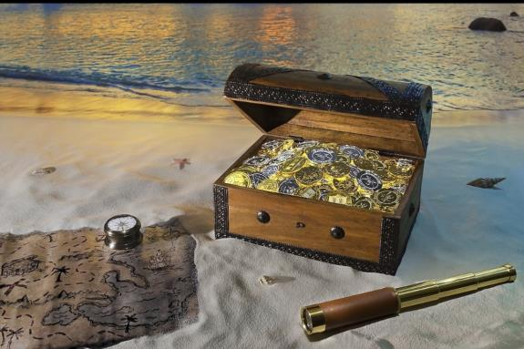

Checking its EXIF data reveals only a misleading comment, so the answer has to be found elsewhere.


Both the challenge title and the filename contain the phrase **treasurehunttrip**, which is odd. Searching for it directly leads nowhere. The description states that everything needed is already in the image, so the next step was to look into unconventional methods of tagging coordinates.

This turned up a pattern similar to geocoding systems: **what3words**, which encodes any ~3 m × 3 m square on Earth as three dictionary words (e.g. `///slurs.this.shark` for the front door of 10 Downing Street). Splitting the phrase into three words gives `treasure.hunt.trip`.

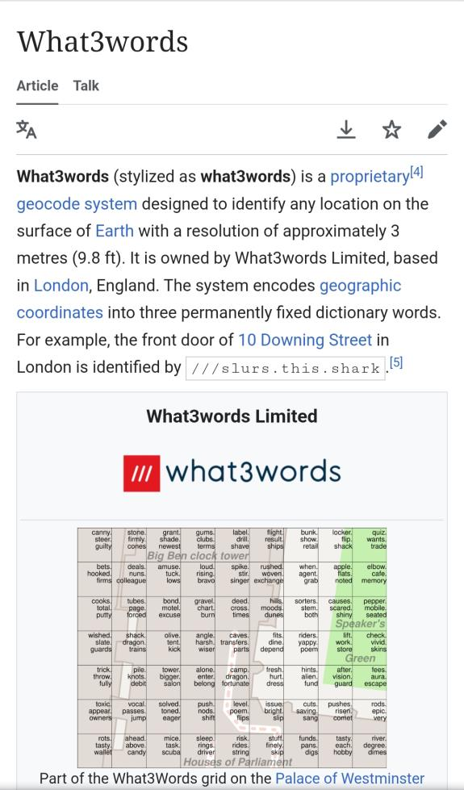

Checking the address on the what3words site returns a valid location.

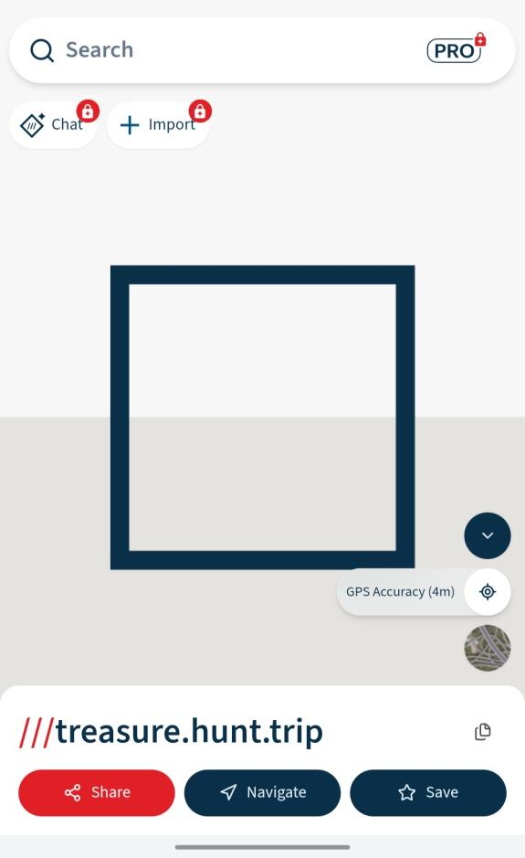

Since what3words' coordinate function is paywalled, an online geocache converter was used to translate the address into coordinates:

```
Coordinates:        S85° 36.011' W081° 05.477'
what3words address: treasure.hunt.trip
Language:           English
```


> **Note:** The converter outputs degrees and decimal minutes. Taking the degrees and whole minutes of each value (`85° 36'` and `81° 05'`) gives `85.36` and `81.05`, which is the flag's format.

### Flag

```
PacketCapture{85.36,81.05}
```

### Tools Used

- what3words
- Geocaching Toolbox (online coordinate converter)

---

## Mirror Identities

**Category:** OSINT
**Difficulty:** Medium

### Description

> Learn how to think outside of the cell. Think outside of the hole he left behind. See the identities linked to it without being named. Your only guidance is the excel they left.

### Provided Files/Artifacts

- Google Sheets link: <https://docs.google.com/spreadsheets/d/1ZXB6pnQEvym9pkDDoSxl49mxiiMAkzx0tS50OuwRt3Q/edit?usp=sharing>

### Solution Walkthrough

We are given a link to a public spreadsheet. Its contents are mostly noise, but the document's metadata can be used to extract the owner's Google account. For this, **xeuledoc** was used.

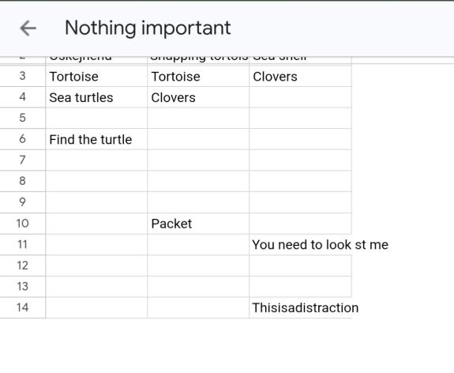

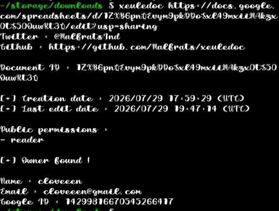

xeuledoc reports the document owner:

- **Name:** cloveeen
- **Email:** cloveeen@gmail.com

Next, **holehe** was used to enumerate the services registered with this email.

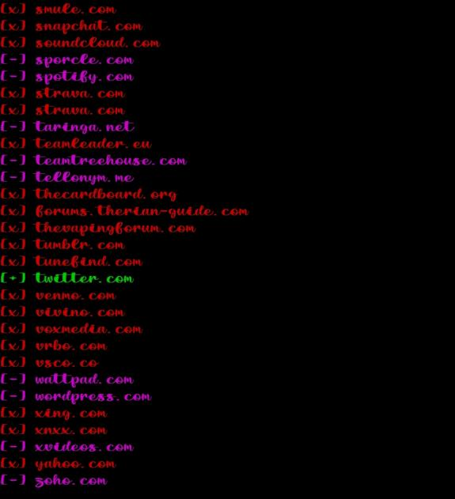

There was one hit: **Twitter/X**. Searching for the name from xeuledoc turns up two accounts. The first (`@Clovendadoor`) is an obvious lead; the second (`@user00195266493`) is a probable dud.

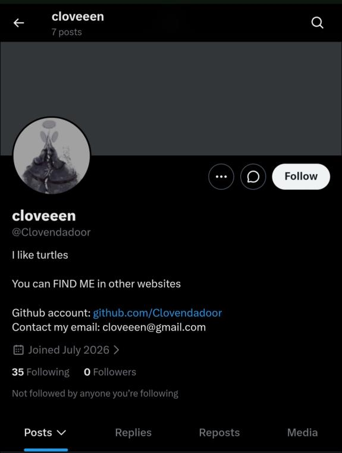

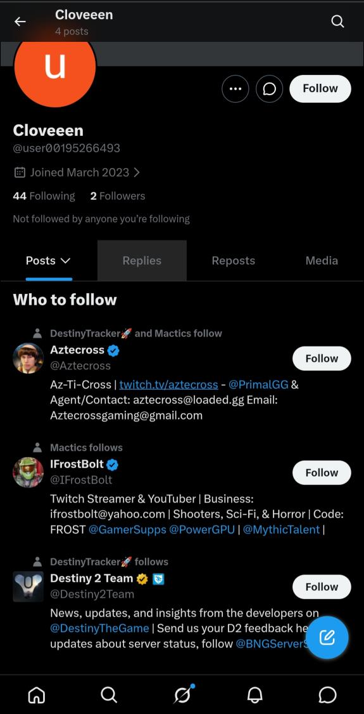

The `@Clovendadoor` profile has several leads: a GitHub account, a contact email, and two interesting tweets. The tweets suggest a **second X account** named after the target's turtles, and a possible **Instagram** account.

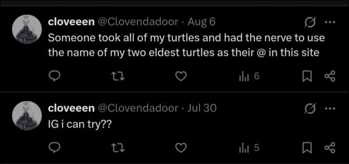

#### GitHub

The GitHub account has a single repository with one commit, containing:

- `README.md`: *"Red is a bit odd and blue is a bit even"*
- `Turts`: `2-7`

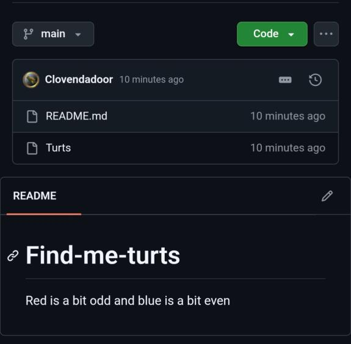

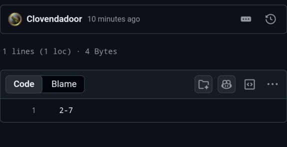

These look like instructions, but it's unclear what they apply to yet, so we pivot to Instagram.

#### Instagram

Searching the same handle on Instagram finds `clovendadoor` with a single post. The caption has two name lists: one marked with a blue circle and one with a red one. This is where the GitHub instructions apply:

- **Blue = even** → position **2** in the blue list → **Namoor**
- **Red = odd** → position **7** in the red list → **Krommer**

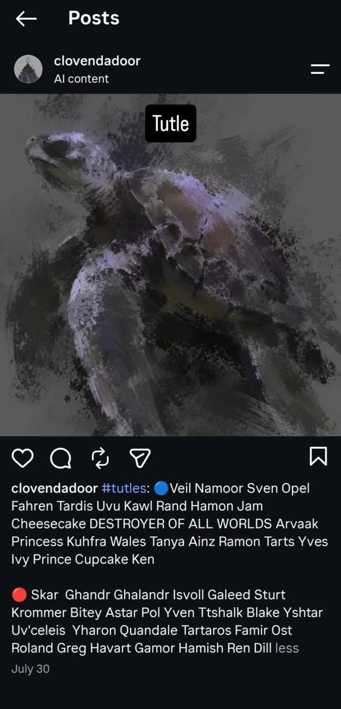

#### Second X account

The target stated that another account uses their pets' names as the handle. Combining the two names gives `@NamoorKrommer`.

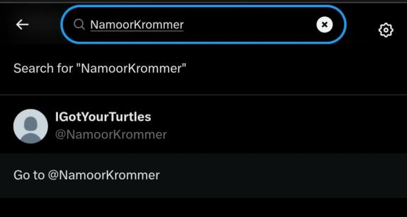

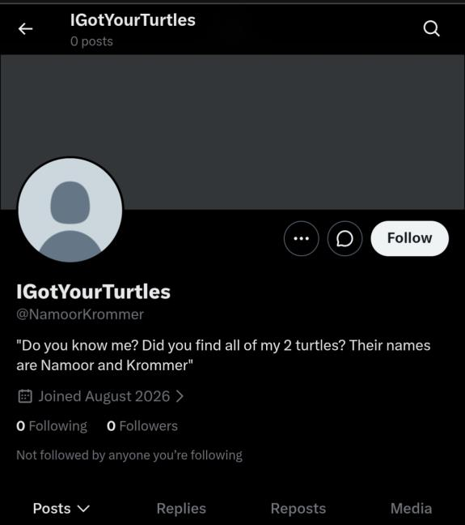

The bio is written in quotation marks, which is curious:

> "Do you know me? Did you find all of my 2 turtles? Their names are Namoor and Krommer"

Remembering that the first account instructed visitors to contact `cloveeen@gmail.com`, this quote is likely a passphrase for an **automated reply**. Sending it to that email returns the flag.


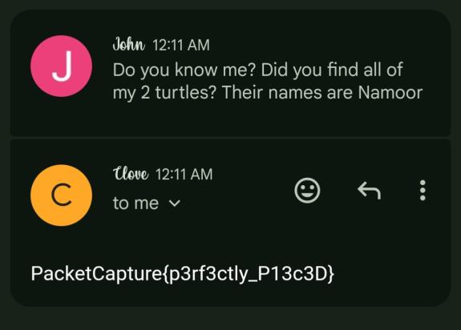

### Flag

```
PacketCapture{p3rf3ctly_P13c3D}
```

### Tools Used

- xeuledoc
- holehe

---

## Digital Footprint

**Category:** OSINT
**Difficulty:** Medium

### Description

> A sub that I was in got banned as of recently. I did hear that they migrated, but rumors started to circulate in our chat server about a member's existence being scrubbed off except on the words of others.

**Sub URL:** <https://www.reddit.com/r/CogitantStray/>

### Solution Walkthrough

The challenge starts with a banned subreddit.

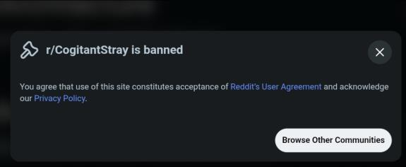

Before scraping the archives of the banned subreddit, we first look for the migration subreddit so we can cross-reference users. Searching for the same name with a suffix finds a small active subreddit: `r/CogitantStrayOficial`.

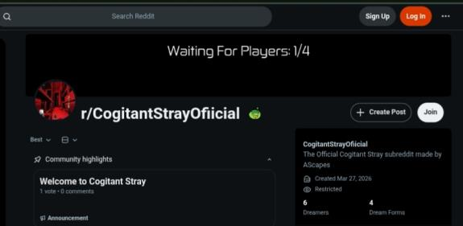

Cross-referencing every name mentioned in both subreddits using **Arctic Shift** produces a huge list that would be tedious to check one by one.

#### Narrowing the list

In the rules of the current subreddit is a Pastebin link, set up as a temporary wiki for the game.

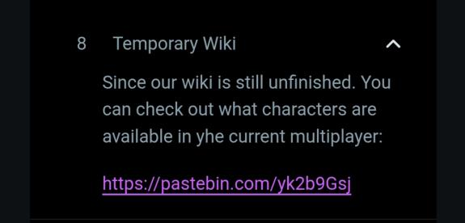

It lists the characters currently available in multiplayer mode, which lets us cross out any names from our list that appear there.

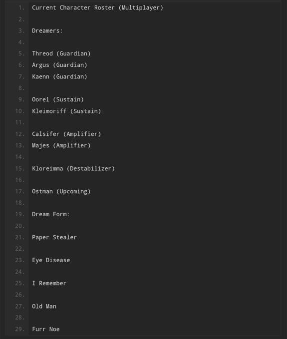

#### Red herrings

Searching further turns up several red herrings, including a curious quote:

> "A Kacelia flower once bloomed, no more shall her dreams linger in my sleep."

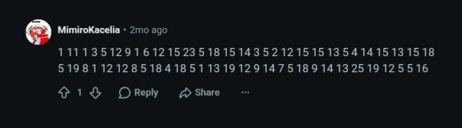

A more useful find is a comment under a deleted comment in a recent post:

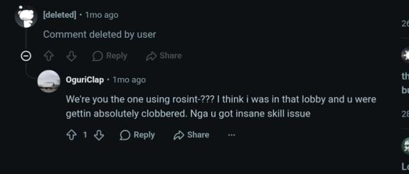

The commenter mentions **rosint**, which is not a character name from the wiki. It is an OSINT tool that pulls from Arctic Shift to make scraping information on a target user easier.

#### Recovering deleted content

Using Rosint on `u/OguriClap` shows the parent comment, which leads to the flag. Repeating the same process on `u/Axusismynameom` reveals the flag in their deleted post.

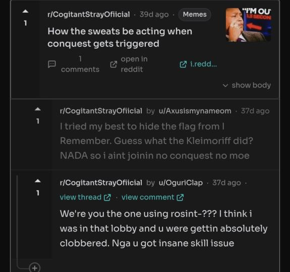

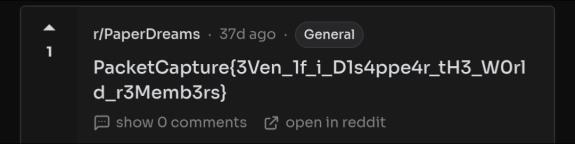

### Flag

```
PacketCapture{3Ven_1f_i_D1s4ppe4r_tH3_W0rld_r3Memb3rs}
```

### Tools Used

- Reddit search
- Arctic Shift
- Rosint

---

## The Final Breadcrumb

**Category:** OSINT
**Difficulty:** Hard

### Description

> We found a zip left behind by a hacker that keeps on breaching our backdoor. He seems to be deliberately leaving crumbs to him. Track it until you find what was left behind.

### Provided Files/Artifacts

A zip file containing:

- Source code
- A PGP fingerprint
- Multiple magenta images (`nature` folder, including `flag.png`)

### Solution Walkthrough

#### Initial triage

The source code has a URL in its comments (`update.sync-center.net`). Visiting it fails with `DNS_PROBE_FINISHED_NXDOMAIN`, so it is a dud and we move on to other points of interest.

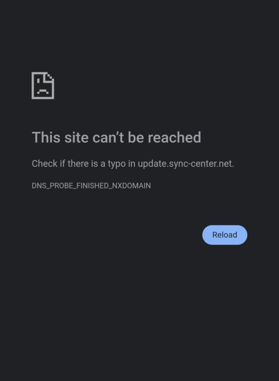

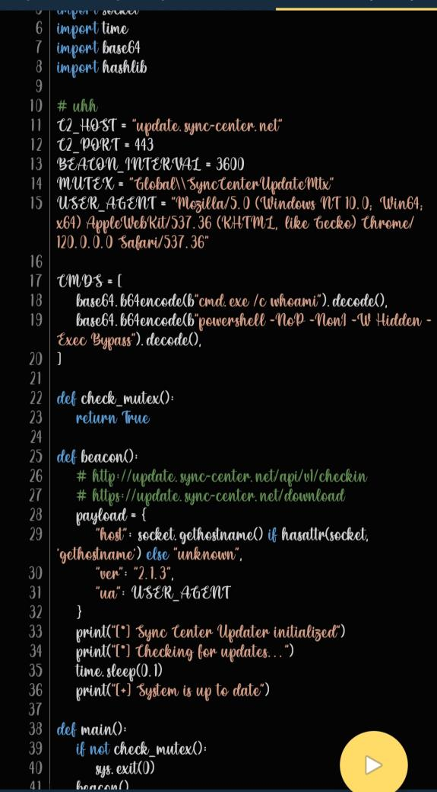

Next, each image is checked for leads, especially `flag.png` because of its name. ExifTool returns only standard metadata, and the same is true of the other two images in the `nature` folder.

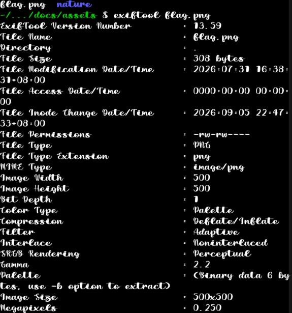

#### PGP fingerprint

Searching the fingerprint on PGP key servers returns one result with an email attached: `Black <magenta-black@mastodon.me>`.

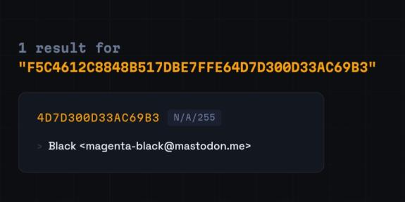

The username `Black` is too generic to find the right account on Mastodon.


Searching Mastodon for the fingerprint itself returns nothing.

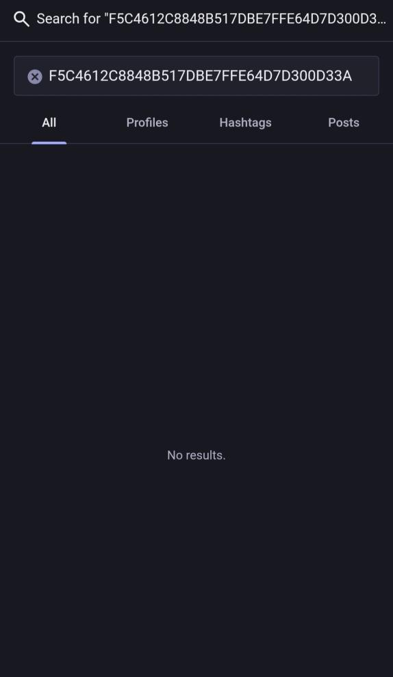

#### YouTube lead

Searching the fingerprint on Google finds a YouTube video on the **PacketCapture** channel. It shows a scene from *Final Destination* and has a text description.

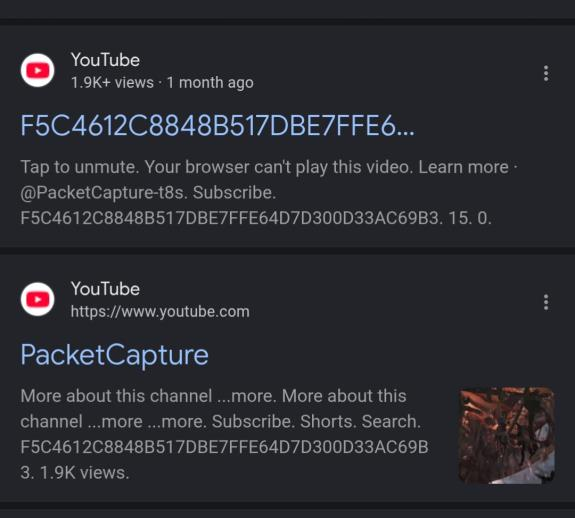

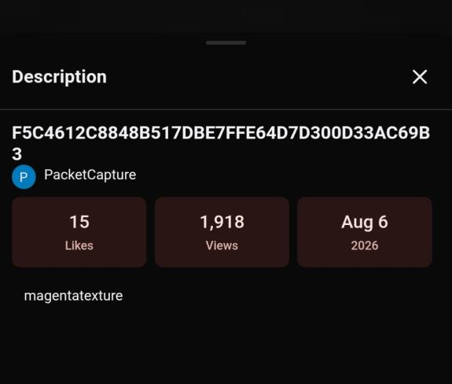

The description contains `magentatexture`. Submitting `PacketCapture{magentatexture}` fails, so something is still missing.

#### Mastodon

The channel description says: *"A mastodon can only handle 30"*. A PGP fingerprint normally has 40 characters, so removing the last 10 should give a hit on Mastodon:

```
Full fingerprint (40): F5C4612C8848B517DBE7FFE64D7D300D33AC69B3
Trimmed (30):          F5C4612C8848B517DBE7FFE64D7D30
```

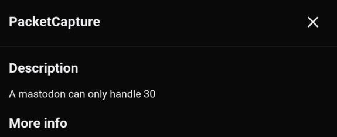

Searching the trimmed value finds an account whose post links to a Pastebin full of Mastodon emails.

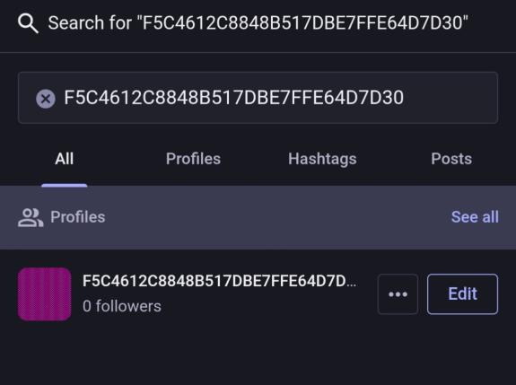

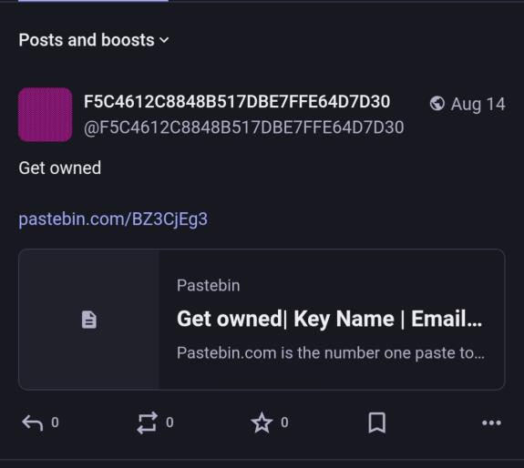

Searching any of those emails leads nowhere because the accounts don't exist. However, everything encountered so far has been black and magenta, and **magenta is missing from the list**.

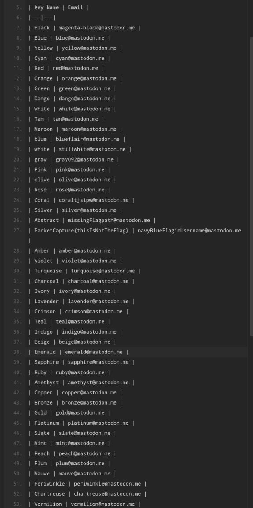

#### Finding the magenta key

Backtracking to the key server and searching for `magenta` gives two results, one of which is new: `M4g3NtaTxtre <magenta@mastodon.me>`. This username is unique enough to search.

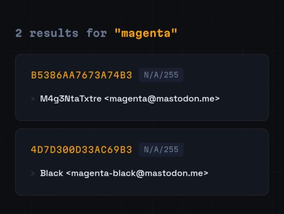

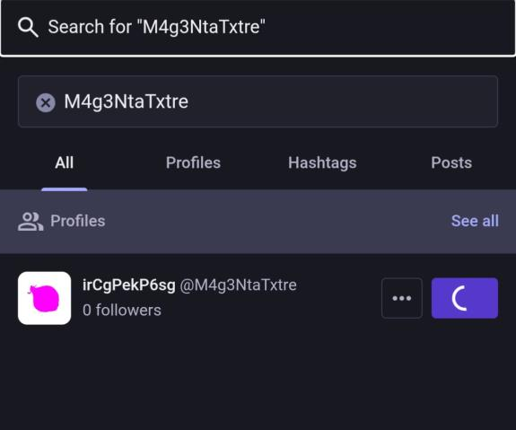

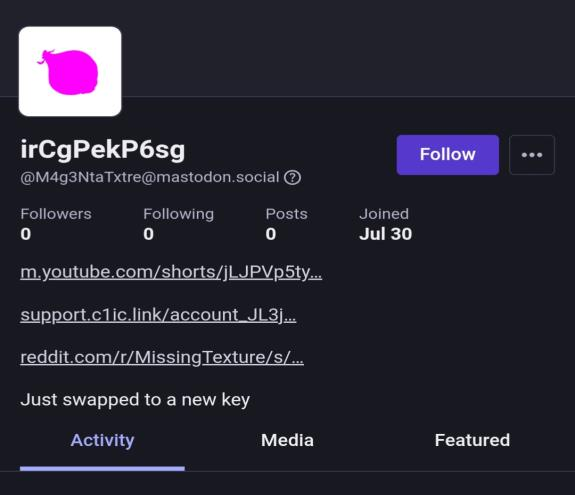

The profile leads down a few paths. Two look plausible: the **support link** and the **YouTube URL** in the nickname (not the link).

#### Path 1: YouTube video

The video, *Hansel and Grettel* by `MagentaHideout`, has an obfuscated string in its description:

```
mofsj7hk44wtsh762nv46lt3bnprcmttbaqxknux66rnaddmyd.
you found the witch house... except it's just a door. there's no house, only address
```

This is a clear jab at the challenge's title. The string is noted for later.

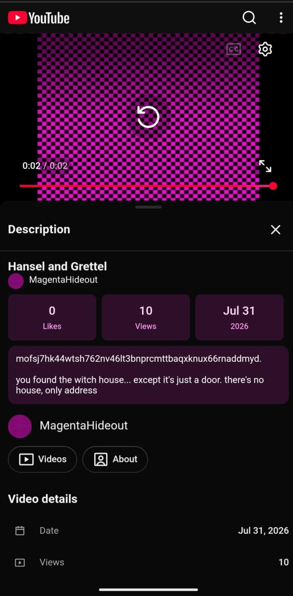

#### Path 2: Support link

The support link leads to a MediaFire download of the account's profile image. ExifTool shows a comment question: *"Why did I become magenta? where's my texture???"*


The filename contains the odd string "fromdinoera", which hints at **steganography**. It's a stretch, but worth checking, and `steghide` prompts for a passphrase.


Magenta and black are the standard replacement for a missing texture, so the passphrase is simply `missing`. The extraction succeeds and writes `shhh.txt`.


The extracted file points to another MediaFire download containing a flag-like string, `PacketCapture{0ld_k3ys_n0_W0rr1es}`, but submitting it fails. It's a red herring, though it left one useful hint: **onion**.


#### Putting it together

Returning to the YouTube description with the onion hint: onion addresses usually start with readable words, which is what the "there's no house, only address" line is about. The obfuscated string is the address, and the "house" (the missing part) is `magentatexture` from the PacketCapture video.

The video itself says this is the final destination, and the channel name is even the flag format. Combining the two gives the flag.


### Flag

```
PacketCapture{magentatexturemofsj7hk44wtsh762nv46lt3bnprcmttbaqxknux66rnaddmyd}
```

### Tools Used

- ExifTool
- PGP key servers
- Steghide
